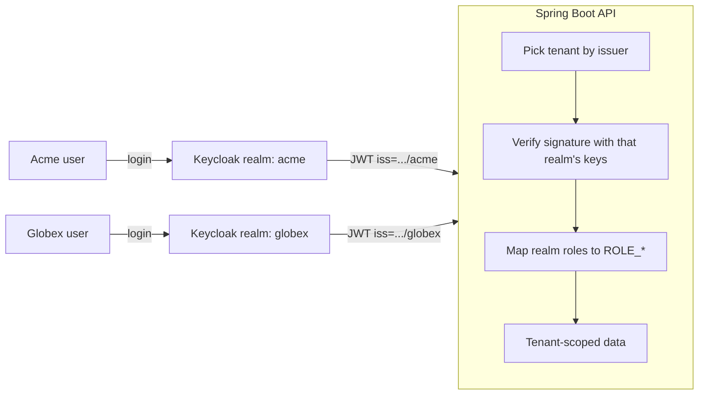

# Multi-tenant Spring Boot API with Keycloak

A Spring Boot 3 / Java 21 REST API that serves several customers (tenants) from one deployment, with each tenant's users kept in its own Keycloak realm. Every request is tied to a tenant by the token that signed it, so one tenant can never see or change another tenant's data.

It's a compact, runnable reference for the patterns I use on real identity and SaaS backends: OAuth2 resource server, per-tenant issuer validation, Keycloak role mapping, and tenant-scoped data access.



## What it shows

- **One API, many realms.** `JwtIssuerAuthenticationManagerResolver` reads the token's issuer, then verifies it with that realm's keys only. Tokens from realms that aren't configured are rejected outright.
- **Tenant comes from the token, not the request.** There's no `X-Tenant-Id` header to tamper with. The tenant is derived from the verified issuer.
- **Role-based access.** Keycloak realm roles (`realm_access.roles`) become Spring authorities, so `user` can read and `admin` can create and delete.
- **No cross-tenant leaks.** Asking for another tenant's project id returns `404`, not `403`, so ids don't reveal that the data exists.
- **Docker-friendly issuer handling.** Tokens are issued for `localhost:8080`, while the API fetches signing keys from `keycloak:8080` inside the Docker network. Issuer and JWK URLs are configured separately so both work.
- **Tests without Keycloak.** Integration tests use `spring-security-test` to cover authorization and isolation rules in milliseconds.

## Run it

Requires Docker only.

```bash
docker compose up --build
```

Keycloak starts on `http://localhost:8080` with two realms imported, and the API on `http://localhost:8081`.

| Tenant | User | Password | Roles |
|---|---|---|---|
| acme | alice | password | user, admin |
| acme | bob | password | user |
| globex | carol | password | user, admin |

The Keycloak admin console is at `http://localhost:8080` (admin / admin).

## Try it

Get a token for a user (password grant is enabled on the demo client for easy testing only):

```bash
token() {
  curl -s -X POST "http://localhost:8080/realms/$1/protocol/openid-connect/token" \
    -d grant_type=password -d client_id=demo-api-client \
    -d username="$2" -d password=password | jq -r .access_token
}

ALICE=$(token acme alice)
BOB=$(token acme bob)
CAROL=$(token globex carol)
```

Then call the API:

```bash
# Who am I? -> {"username":"alice","tenant":"acme","roles":[...]}
curl -s localhost:8081/api/me -H "Authorization: Bearer $ALICE"

# Each tenant sees only its own projects
curl -s localhost:8081/api/projects -H "Authorization: Bearer $BOB"     # acme projects
curl -s localhost:8081/api/projects -H "Authorization: Bearer $CAROL"   # globex projects

# Admins can create, regular users get 403
curl -s -X POST localhost:8081/api/projects -H "Authorization: Bearer $ALICE" \
  -H "Content-Type: application/json" -d '{"name":"New dashboard"}'
curl -s -o /dev/null -w "%{http_code}\n" -X POST localhost:8081/api/projects \
  -H "Authorization: Bearer $BOB" -H "Content-Type: application/json" -d '{"name":"Nope"}'
```

## API

| Method | Path | Access |
|---|---|---|
| GET | `/api/public/ping` | anyone |
| GET | `/api/me` | any authenticated user |
| GET | `/api/projects` | any user of the tenant |
| GET | `/api/projects/{id}` | any user of the tenant |
| POST | `/api/projects` | tenant `admin` |
| DELETE | `/api/projects/{id}` | tenant `admin` |

## Adding a tenant

1. Create a realm in Keycloak (or add a `keycloak/<tenant>-realm.json` file).
2. Add it to `app.tenants` in `src/main/resources/application.yml`.

No code changes are needed.

## Project layout

```
src/main/java/dev/mihab/tenantauth/
  security/SecurityConfig.java        per-tenant JWT validation and URL rules
  security/KeycloakRoleConverter.java realm roles -> ROLE_* authorities
  tenant/TenantResolver.java          verified issuer -> tenant id
  project/                            tenant-scoped sample domain
keycloak/                             realm exports imported on startup
```

## Running tests

```bash
mvn test
```

## Production notes

This is a reference project, so a few things are intentionally simple:

- Projects are stored in memory. In production, use a database with a `tenant_id` column (or schema per tenant) and keep the tenant filter in the repository layer.
- Disable the password grant and use the authorization code flow with PKCE for real clients.
- Add audience (`aud`) validation once each API has its own Keycloak client.
- Run Keycloak in production mode with HTTPS.

## License

MIT
